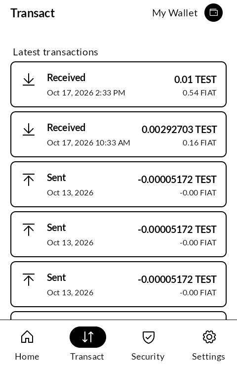
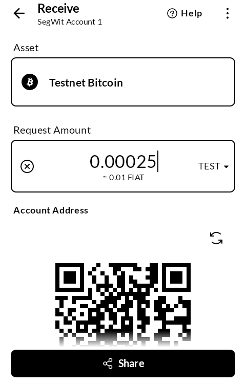
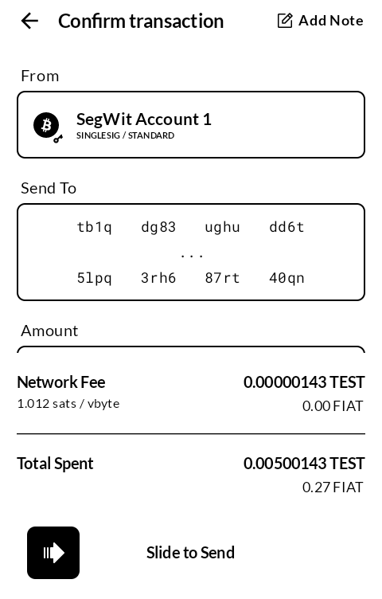
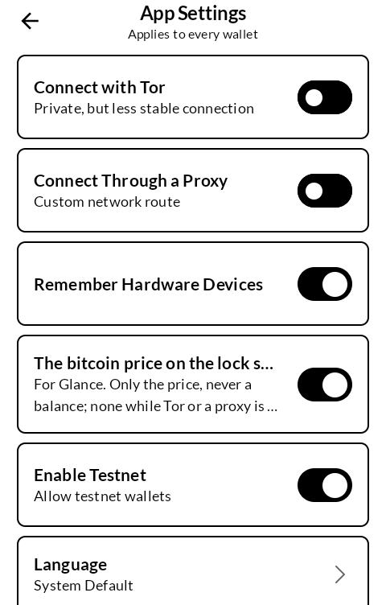

# 銭 zeni — Bitcoin

A Bitcoin wallet for an E Ink phone. Black on white, Lato, nothing that slides.

*Zeni* is the old word for a coin: small money, the kind you hand across.

Built for the [Mudita Kompakt](https://mudita.com/products/kompakt/), whose 4.3" panel has
sixteen greys and a slow redraw, and used with a
[Blockstream Jade](https://blockstream.com/jade/) over Bluetooth.

## Screenshots

| | | | |
|---|---|---|---|
|  |  |  |  |

*A testnet wallet from the public BIP39 test phrase; testnet coins have no value.*

## What it is

This is an independent fork of Blockstream's [Green](https://github.com/Blockstream/green_android)
(now *Blockstream App*), dressed for E Ink. **It is not affiliated with, endorsed by or supported
by Blockstream.** It carries no Blockstream logo, help desk or terms of its own; support is
email@wanderthe.dev and nothing else.

Everything that makes it a good wallet is theirs and unchanged: GDK, the
wallet library underneath; hardware wallet signing; watch-only wallets from an xpub or a
descriptor; wallets kept on the phone, created or restored from a recovery phrase; coin
control, fees, Tor, and your own Electrum server if you have one.

What is mine is how it looks on this screen, and what it leaves out.

## What changed for E Ink

**Bitcoin only.** Liquid, Lightning, AMP, swaps, buying and the promotions are gone, and so are
the background calls behind them. What is left is an on-chain wallet.

**One appearance.** Black and white, Lato in place of Inter, solid text, a plain price chart.
No animations: every transition and every Rive drawing is gone, because a moving picture on
this panel is a smear.

**No pictures in setup.** The device drawings and the Jade pitch are gone from setup, from
signing in and from the device sheets. The words stay: *Turn on your hardware wallet and
unlock it.*

**Settings as ruled rows,** tab labels always shown, dialogs with a black rim instead of a dim
behind them, and only real hardware wallets in the Bluetooth list.

## Tap to pay

Two phones held back to back can hand a payment request across over NFC.

The one being paid opens **Receive**, sets an amount if it wants one, and holds the other phone
to its back. The phone paying, with zeni open, reads the request and opens **Send** with the
address and amount filled in. Then it is an ordinary send: you check it, and you sign it on your
hardware wallet or with your PIN.

**A tap only proposes, never sends.** Nothing leaves either wallet until the payer confirms.

Both phones need zeni. A Kompakt's NFC chip keeps the standard tag address for itself, so zeni
answers on an address of its own, and a payer running zeni asks there. The QR code stays on the
Receive screen for everyone else.

## On the lock screen

For anyone who uses [Glance](https://github.com/wanderwildwood/hitome), zeni can put the bitcoin
price on the lock screen: Settings → *The bitcoin price on the lock screen*. Off until you
switch it on. Only the price, never a balance, and none while Tor or a proxy is on.

## Getting it, and keeping it

Download <https://github.com/wanderwildwood/zeni/releases/latest/download/zeni.apk> and
sideload it. That address always points at the newest release, and every release publishes a
`.sha256` beside the APK.

For updates, add this repository to [Obtainium](https://github.com/ImranR98/Obtainium):

    https://github.com/wanderwildwood/zeni

It installs beside Blockstream App rather than over it. A wallet in one is not in the other:
add it again, from your hardware wallet or your recovery phrase.

## Building

```
./gradlew :androidApp:assembleProductionFDroidRelease
```

The APK is built for 64-bit ARM only; add `-PabiFilter=x86_64` for an emulator.

A release is signed by a keystore in `signing/`, which is not in this repository. Without it
the release APK builds **unsigned** and will not install anywhere — there is no fallback key
by design.

## Privacy

Privacy: what the app stores and what it sends is set out in [PRIVACY.md](PRIVACY.md).

zeni is the F-Droid build of Green: no Google services, no analytics, no crash reports, no
update check. The developer runs no server and receives nothing.

These are all the servers it contacts, and when:

| Server | When | What it learns |
|---|---|---|
| Blockstream's Electrum server (`bitcoin-mainnet.blockstream.info`, or `bitcoin-testnet` for a testnet wallet) | While a wallet is open | The wallet's addresses, to read balance and history; transactions you sign, to send them. Your own server instead, if you set one in App Settings. |
| Blockstream's Green server (`green-bitcoin-mainnet.blockstream.com`) | Each time a wallet opens | A login, so a Green two-factor (multisig) account can be found. |
| Blockstream's price chart (`green-btc-chart.blockstream.com`) | When the wallet list or a wallet's home page opens | The currency you show amounts in. |
| Blockstream's PIN server (`jadepin.blockstream.com`) | Unlocking a Jade, or a phone wallet with its PIN | A blinded exchange; it never learns the PIN or the keys. |
| Blockstream's Jade firmware server (`jadefw.blockstream.com`) | When a Jade connects | A request for the list of firmware. Firmware downloads only if you agree. |

The exchange rate for the fiat value beside amounts comes over these same connections; there
is no separate price service.

**With Tor or a proxy on, every one of these goes through it.** Tor uses Blockstream's onion
addresses where they have them. Nothing goes around it.

Besides those:

- **Your hardware wallet**, over Bluetooth or USB.
- **The other phone**, over NFC, only while zeni's Receive screen is open or zeni is reading
  a tap. What passes is the payment request (an address and an amount) and nothing else.
- **Glance**, only if you switch on the lock-screen price: the price from the chart server
  above, fetched when the lock screen is looked at and the last one is over half an hour old,
  and never while Tor or a proxy is on. Never a balance.
- **Links you press** open in your browser: Blockstream's help pages (about the wallet
  technology, not this app's), the donation page, the author's site.
- **Contact** in About opens your email app with a blank message to email@wanderthe.dev.
  Nothing is attached or sent until you send it.

Its permissions: internet, Bluetooth (to find and talk to a hardware wallet), camera (to scan
a QR code, asked for when you scan), NFC, notifications, and fingerprint (only if you choose to
unlock with it). Green and its libraries also declare storage, keep-awake and start-at-boot
permissions; zeni adds none of those.

Your keys stay on your hardware wallet, or encrypted on the phone for a wallet kept there.

## Licence

Based on Blockstream Green, GPL-3.0, © Blockstream Corporation Inc. and contributors.

**GNU General Public License v3.0 only**, as Blockstream publishes Green. See [LICENSE](LICENSE).
The app shows the full text, the source link and everything it is built with under
About, Licences; Privacy and Terms are there too ([PRIVACY.md](PRIVACY.md), [TERMS.md](TERMS.md)).

Green is © Blockstream Corporation Inc. and contributors; zeni is a fork of it, and their
copyright and licence stay with every part that is theirs. Blockstream's names and logo belong to
Blockstream and are not used here as this app's own; this app is not affiliated with or endorsed
by Blockstream. Lato is © Łukasz Dziedzic, SIL Open Font License 1.1 ([LICENSES/OFL-1.1.txt](LICENSES/OFL-1.1.txt)).

Copyright © wander wildwood for the parts that are mine.
